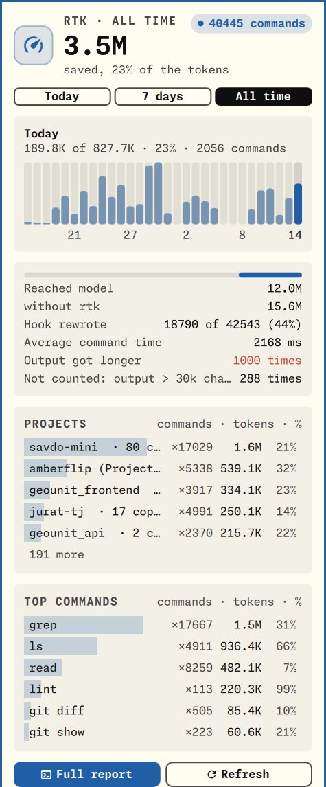

# rtk for the Omarchy bar

How many tokens [rtk](https://github.com/rtk-ai/rtk) saved your AI agent, in the
[Omarchy](https://omarchy.org) bar — and a popup with a chart, the totals, your projects and
the commands that saved the most. The numbers are counted exactly like `rtk gain`, so the two
always agree. Readable for people with low vision; English and Russian.

[Русская версия](README.ru.md)



In the bar: `󰓅 83.8K` — tokens saved today.
Left click opens the popup, right click refreshes, middle click opens `rtk gain --graph` in a
floating terminal.

## What the popup shows

- **A chart** of tokens saved per hour (today) or per day (7 days; all time shows the last 30
  days). Hover a column or press `←`/`→` to read it. The current hour or day is lit.
- **Totals** for the period — the same ones `rtk gain` prints: rows whose raw output was over ~30k
  characters (Claude Code's Bash cap) are left out, and a row where rtk printed *more* than the raw
  command counts as zero saved, not as a loss. Both kinds are counted in their own lines.
- **Reached the model / without rtk** — the strip under the chart; its accent part is what rtk cut.
- **Hook rewrote** — of all Bash calls the Claude Code hook saw, how many became `rtk …`.
- **Projects**, grouped by git repository, so worktrees and copies of one repo are a single row.
  Click a row for its copies and its own top commands; click again to go back.
- **Top commands** by tokens saved. `git status` and `git diff` are separate rows.

Keys: `Esc` close · `1` `2` `3` today / 7 days / all time · `p` next period · `←` `→` step through
the chart · `↑` `↓` pick a project · `m` more projects · `r` refresh · `Enter` full report · `Tab` next panel.

## Install

```bash
omarchy plugin add https://github.com/ismoil77/omarchy-rtk --enable
```

Remove it with `omarchy plugin remove ismoil.rtk`; the cache folder `~/.cache/ismoil-rtk/` can then be deleted.

You need `rtk` itself (the widget reads its history database, it does not run it) and Python 3.9+.

## Settings

On the widget's entry in `~/.config/omarchy/shell.json`, or in the shell's settings panel:

| Setting | Default | |
|---|---|---|
| `period` | `today` | Popup period: `today`, `week`, `all`. The popup's buttons change it too. |
| `language` | `auto` | `auto` follows the system locale; or `en`, `ru`. |
| `textSize` | `Normal` | `Normal`, `Large`, `Extra large`. Text is never smaller than 13 px. |
| `animations` | `true` | Turn off to stop the columns and meters from sliding. |
| `interval` | `30` | Seconds between reads of the bar total while the popup is closed (at least 5). |
| `database` | *(empty)* | Path to rtk's `history.db`. Empty means rtk's own location (`$XDG_DATA_HOME/rtk/history.db`, by default `~/.local/share/rtk/history.db`). |

IPC: `omarchy-shell shell toggle ismoil.rtk '{}'`.

## Made to be read

Text never drops below 13 px and scales with `textSize`; every colour used for text is nudged to at
least WCAG AA contrast (4.5:1) on the popup background, whatever the theme; the accent follows
`omarchy theme set`. Nothing is conveyed by colour alone — the red line is also labelled. The popup
scrolls when large text outgrows the screen.

## Privacy and safety

The widget opens rtk's database **read-only** and never writes to it. It makes no network calls.
The only thing it writes is a small cache of folder → project lookups in
`$XDG_CACHE_HOME/ismoil-rtk/paths-v6.json`, so deleted worktrees still land in their project.
That cache holds your project and worktree paths, so its folder is owner-only (0700) and its
files 0600, whatever your umask; a cache left open by an older version is tightened on the next run.
It runs `git` in your project folders to find the repository they belong to.

## Another language

Add a table to `Strings.js` (same keys as `en`, same `{placeholders}`, plural forms as arrays) and its
code to `langs`. `tests/strings.test.mjs` checks the tables match; for a language with different
plural rules, add its rule to `kit/I18n.js`.

## Development

```bash
tests/run.sh                         # Python, Node, Qt's own QML engine, omarchy plugin validate
python3 tests/make_demo_db.py /tmp/demo   # a made-up history + repos, for screenshots
```

Point the widget at the demo with `"database": "/tmp/demo/history.db"`. After QML edits use
`omarchy restart shell` — hot reload can leave stale bar widgets.

`stats.py` prints one language-free JSON object; the widget translates it. `kit/` holds the parts
that are not about rtk — contrast, translation helpers, the popup's look and its list, chart and
meter components — and is shared with other widgets (see
[omarchy-widget-kit](https://github.com/ismoil77/omarchy-widget-kit)); edit it there, not here.

## License

MIT
