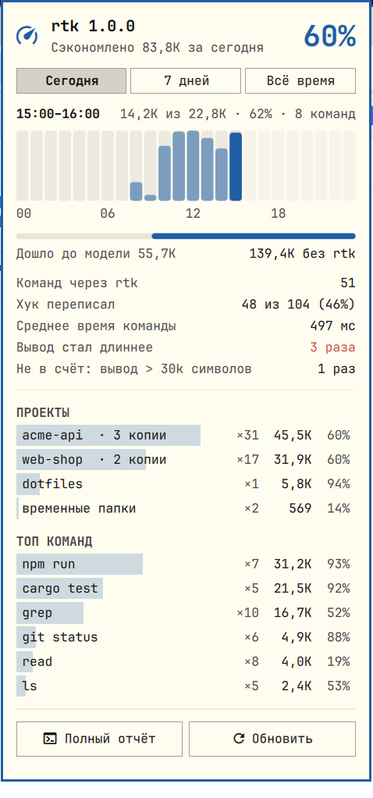

# rtk в панели Omarchy

Сколько токенов [rtk](https://github.com/rtk-ai/rtk) сэкономил вашему ИИ-агенту — в панели
[Omarchy](https://omarchy.org), а по клику — график, итоги, проекты и команды, которые сэкономили
больше всего. Цифры считаются ровно как в `rtk gain`, поэтому всегда с ним совпадают. Читается при
слабом зрении; английский и русский.

[English](README.md)



В панели: `󰓅 83,8K` — токены, сэкономленные сегодня.
Левый клик — окно, правый — обновить, средний — `rtk gain --graph` в плавающем терминале.

## Что в окне

- **График** сэкономленных токенов по часам (сегодня) или по дням (7 дней; «всё время» — последние
  30 дней). Наведите на столбец или жмите `←`/`→`. Текущий час или день подсвечен.
- **Итоги** за период — те же, что печатает `rtk gain`: строки, где сырой вывод длиннее ~30k
  символов (предел Bash-вывода Claude Code), в итог не входят, а строка, где rtk вывел *больше*
  исходной команды, считается как ноль, а не как убыток. Оба вида считаются в своих строках.
- **Дошло до модели / без rtk** — полоса под графиком; цветная часть — то, что срезал rtk.
- **Хук переписал** — из всех Bash-вызовов, что видел хук Claude Code, сколько стали `rtk …`.
- **Проекты** по git-репозиториям: worktree и копии одного репозитория — одна строка. Клик по строке
  — её копии и свои топ-команды; ещё клик — назад.
- **Топ команд** по сэкономленным токенам. `git status` и `git diff` — разные строки.

Клавиши: `Esc` закрыть · `1` `2` `3` сегодня / 7 дней / всё время · `p` следующий период · `←` `→`
по графику · `r` обновить · `Enter` полный отчёт · `Tab` следующая панель.

## Установка

```bash
omarchy plugin add https://github.com/ismoil77/omarchy-rtk --enable
```

Нужен сам `rtk` (виджет читает его базу истории, но не запускает его) и Python 3.9+.

## Настройки

В записи виджета в `~/.config/omarchy/shell.json` или в панели настроек шелла:

| Настройка | По умолчанию | |
|---|---|---|
| `period` | `today` | Период окна: `today`, `week`, `all`. Кнопки окна меняют его тоже. |
| `language` | `auto` | `auto` — по локали системы; или `en`, `ru`. |
| `textSize` | `Normal` | `Normal`, `Large`, `Extra large`. Текст не мельче 13 px. |
| `animations` | `true` | Выключите, чтобы столбцы и полосы не плыли. |
| `interval` | `30` | Секунд между чтениями итога для панели, пока окно закрыто (не меньше 5). |
| `database` | *(пусто)* | Путь к `history.db` rtk. Пусто — штатное место rtk (`$XDG_DATA_HOME/rtk/history.db`). |

IPC: `omarchy-shell shell toggle ismoil.rtk '{}'`.

## Чтобы читалось

Текст не мельче 13 px и растёт с `textSize`; каждый цвет текста подтягивается минимум до контраста
WCAG AA (4,5:1) на фоне окна, какая бы ни была тема; акцент следует за `omarchy theme set`. Ничто не
передаётся одним цветом — красная строка ещё и подписана. Окно прокручивается, если крупный текст не
влезает в экран.

## Приватность и безопасность

Виджет открывает базу rtk **только на чтение** и ничего в неё не пишет. Сетевых вызовов нет. Пишет он
только небольшой кэш «папка → проект» в `$XDG_CACHE_HOME/ismoil-rtk/paths-v4.json`, чтобы удалённые
worktree всё равно попадали в свой проект. В ваших папках он запускает `git`, чтобы найти репозиторий.

## Другой язык

Добавьте таблицу в `Strings.js` (те же ключи, что в `en`, те же `{подстановки}`, формы слов —
массивами) и её код в `langs`. `tests/strings.test.mjs` проверит, что таблицы совпадают; для языка с
другими правилами множественного числа добавьте правило в `kit/I18n.js`.

## Разработка

```bash
tests/run.sh                              # Python, Node, QML-движок Qt, omarchy plugin validate
python3 tests/make_demo_db.py /tmp/demo   # выдуманная история и репозитории для скриншотов
```

Направьте виджет на демо: `"database": "/tmp/demo/history.db"`. После правок QML — `omarchy restart
shell`: горячая перезагрузка может оставить старые виджеты панели.

`stats.py` печатает один JSON без слов на каком-либо языке, переводит виджет. В `kit/` — то, что не
про rtk: контраст, помощники перевода, внешний вид окна и его компоненты (список, график, полоса).
Он общий с другими виджетами (см. [omarchy-widget-kit](https://github.com/ismoil77/omarchy-widget-kit));
правьте его там, не здесь.

## Лицензия

MIT
